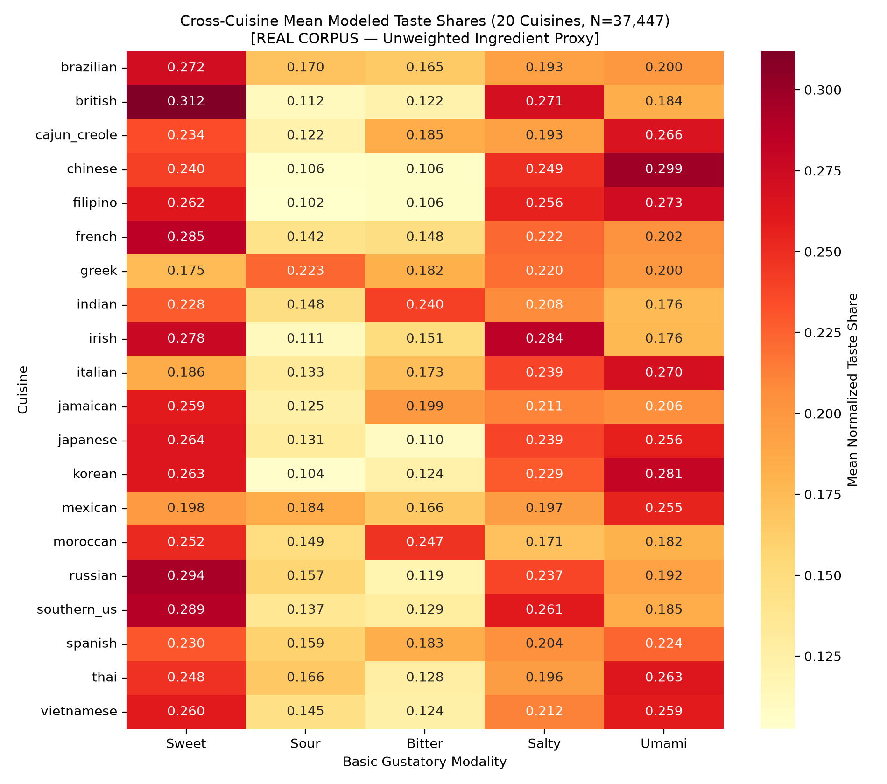
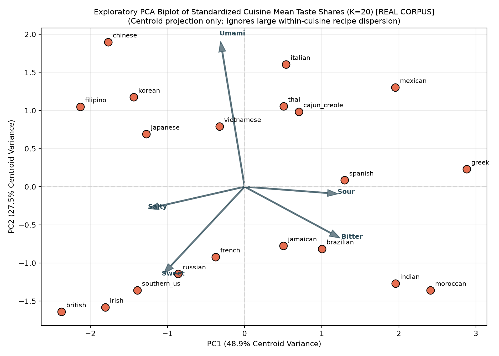
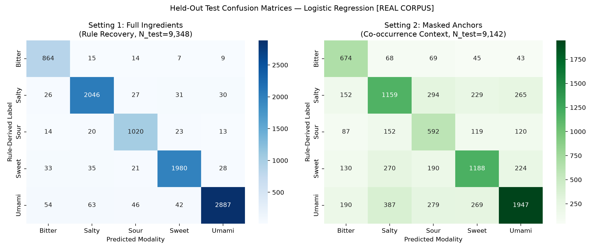
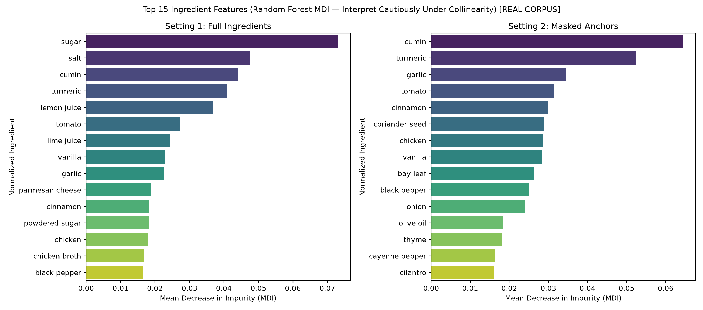

# Computational Analysis and Prediction of Taste Profiles in Recipes

An end-to-end, reproducible computational gastronomy framework and deployable FastAPI web application that maps unstructured recipe ingredient lists to FlavorDB-verified 5-dimensional basic taste proxy profiles (`sweet`, `sour`, `bitter`, `salty`, `umami`), evaluates cross-cuisine variation using non-parametric and compositional statistics, and benchmarks leak-free classifiers that separate circular proxy recovery from contextual ingredient co-occurrence.

---

## 1. Research Questions
1. **Data Engineering & Provenance:** Can raw recipe ingredient lists be normalized without collapsing distinct culinary ingredients (`garlic` vs. `black garlic` vs. `garlic powder`; `beef` vs. `beef broth`; `lemon` vs. `lemon juice`) while separating volatile aroma molecules and trigeminal chemesthesis from basic lingual taste?
2. **Simplex Taste Representation:** How can recipe-level taste-share vectors be formulated on the 4-simplex ($\sum p_d = 1$) with explicit handling of unknown (`NaN`) dimensions and quantified via Shannon entropy ($H$) and Pielou evenness ($J$)?
3. **Cross-Cuisine Statistical Differentiation:** Do world cuisines differ significantly in modeled taste shares under Holm–Bonferroni-corrected Kruskal–Wallis tests and joint Aitchison Centered Log-Ratio (CLR) PERMANOVA?
4. **Predictive Modeling & Circularity Control:** When primary taste anchors and surface-alias variants are removed, how accurately do remaining companion ingredients predict the proxy `dominant_taste` label via culinary co-occurrence?

---

## 2. Pipeline Architecture

```
                         [ RAW RECIPE CORPUS ]
             data/raw/train.json (39,774 Kaggle/Yummly recipes)
            OR explicit --use-sample-data (184 synthetic records)
                                   |
                                   v
===========================================================================
DELIVERABLE 1: DATASET & PROVENANCE (src/data_preprocessing.py)
 - Schema validation (id, cuisine, ingredients) & SHA-256 manifest
 - Deterministic normalization via data/raw/ingredient_aliases.csv (380 rules)
 - Within-cuisine deduplication (preserves 55 cross-cuisine shared sets)
 - Verified 122-entry lexicon (data/raw/ingredient_taste_lexicon.csv)
   with FlavorDB entity_id cross-checks, chemesthesis tags, & NaN unknowns
===========================================================================
                                   |
                                   v
===========================================================================
DELIVERABLE 2: TASTE SIMPLEX & EVENNESS (src/taste_profile.py)
 - NaN-aware unweighted presence mean (optional quantity-weight hook)
 - L1 simplex shares p_d(r) summing to 1.0 across 37,447 sufficient recipes
 - Shannon entropy H (mean 1.3892 nats) & Pielou evenness J (mean 0.8631)
===========================================================================
                                   |
              +--------------------+--------------------+
              |                                         |
              v                                         v
======================================   ======================================
DELIVERABLE 3: CROSS-CUISINE ANALYSIS    DELIVERABLE 4: ML & RETRIEVAL
(src/cuisine_analysis.py)                (src/taste_prediction.py)
 - 20 cuisines, descriptive & z-lifts     - Pre-split bag deduplication
 - Kruskal-Wallis + Holm-Bonferroni       - Pipeline CV (zero vocab leakage)
 - Bootstrap 95% CIs on eta_H^2           - Setting 1: Full (Rule recovery)
 - Multiplicative-zero CLR + PERMANOVA    - Setting 2: Masked 43 anchors + regex
 - Standardized PCA centroid biplot       - Dual bundle models/taste_model.joblib
                                          - Cosine retrieval & FastAPI web app
======================================   ======================================
```

---

## 3. Key Verified Findings (Kaggle / Yummly Real Corpus, $N = 37,447$)

### Data Construction & Coverage
- **Cleaned Unique Recipes:** `38,979` across `20` cuisines (`795` within-cuisine duplicates removed; `55` cross-cuisine identical sets preserved).
- **Lexicon Matching:** `120` taste-annotated entries + `2` taste-unknown lipids (`cooking oil`, `peanut oil`) matched **64.05%** of all ingredient tokens (`266,841 / 416,607`). `6,073` long-tail/composite items remain unmatched and are logged explicitly in `data/processed/ingredient_flavor_mapping.csv`.

### Cross-Cuisine Statistical Comparison (`results/cuisine_comparison.csv`)
- **Univariate Kruskal–Wallis ($df=19$, Holm–Bonferroni adjusted):** All five taste dimensions and evenness $J$ show statistically significant variation ($p_{\text{adj}} < 10^{-300}$), led in effect size by **bitter** ($\eta_H^2 = 0.1611$, 95% CI `[0.1530, 0.1670]`) and **umami** ($\eta_H^2 = 0.1341$, `[0.1285, 0.1390]`), down to **salty** ($\eta_H^2 = 0.0429$, `[0.0395, 0.0467]`).
- **Joint Compositional PERMANOVA (Aitchison CLR, 299 permutations):** Pseudo-$F = 79.25$, $p = 0.0033$, **$R^2_{\text{Aitchison}} = 3.87\%$** — demonstrating that while cuisine differences are statistically robust, within-cuisine recipe diversity accounts for the vast majority of compositional variance.
- **Notable Modality Elevations ($z$-score lift):** Moroccan (`bitter`, $z=+0.90$), Indian (`bitter`, $z=+0.83$), Greek (`sour`, $z=+0.69$), Chinese (`umami`, $z=+0.53$), British (`sweet`, $z=+0.52$), and Irish (`salty`, $z=+0.41$).




### Machine Learning Benchmarks (`results/model_comparison.csv`)
Because `dominant_taste` is derived from the lexicon rather than human taste panels, we separate **Setting 1** (rule recovery) from **Setting 2** (contextual prediction after masking 43 direct taste anchors and anchor-family regex patterns, plus removing 182 post-masking train/test duplicate collisions):

| Evaluation Setting | Model | 5-Fold CV Macro-F1 | Test Accuracy [95% CI] | Test Macro-F1 [95% CI] |
| :--- | :--- | :---: | :---: | :---: |
| **Setting 1 (Full Ingredients)** | DummyClassifier (Most Frequent) | 0.0994 $\pm$ 0.0000 | 0.3308 [0.3228, 0.3401] | 0.0994 [0.0976, 0.1015] |
| **Setting 1 (Full Ingredients)** | **LogisticRegression (L2, Balanced)** | **0.9242 $\pm$ 0.0016** | **0.9411 [0.9365, 0.9453]** | **0.9345 [0.9290, 0.9397]** |
| **Setting 1 (Full Ingredients)** | RandomForest (150 trees, Balanced) | 0.7157 $\pm$ 0.0068 | 0.7441 [0.7345, 0.7526] | 0.7207 [0.7106, 0.7292] |
| **Setting 2 (Masked Anchors)** | DummyClassifier (Most Frequent) | 0.0996 $\pm$ 0.0000 | 0.3360 [0.3271, 0.3466] | 0.1006 [0.0986, 0.1029] |
| **Setting 2 (Masked Anchors)** | **LogisticRegression (L2, Balanced)** | **0.5918 $\pm$ 0.0062** | **0.6082 [0.5978, 0.6169]** | **0.5942 [0.5830, 0.6038]** |
| **Setting 2 (Masked Anchors)** | RandomForest (150 trees, Balanced) | 0.5542 $\pm$ 0.0069 | 0.5671 [0.5556, 0.5765] | 0.5479 [0.5368, 0.5579] |




---

## 4. Repository Structure

```
computational-gastronomy/
├── api/
│   └── index.py                             <- Vercel serverless FastAPI entrypoint
├── app/
│   ├── main.py                              <- Deployable FastAPI REST API & UI backend
│   ├── engine.py                            <- Zero-heavy-dep pure-Python inference & retrieval
│   └── static/                              <- Responsive web explorer (index.html, styles.css, app.js)
├── data/
│   ├── raw/
│   │   ├── ingredient_taste_lexicon.csv     <- 122-entry FlavorDB-verified taste proxy lexicon
│   │   ├── ingredient_aliases.csv           <- 380 deterministic canonical alias mappings
│   │   └── train.json                       <- Kaggle / Yummly dataset (gitignored; user-supplied)
│   ├── processed/                           <- Clean CSVs & recipe taste features
│   └── dataset_manifest.json                <- Machine-readable SHA-256 & provenance manifest
├── docs/
│   ├── quality_audit.md                     <- Full scientific & software audit report
│   ├── validation_report.md                 <- End-to-end validation & test report
│   ├── project_proposal.md                  <- Research objectives & deliverables
│   └── final_report.md                      <- Complete academic manuscript
├── models/
│   ├── taste_model.joblib                   <- Dual Setting 1 + Setting 2 sklearn Pipeline bundle
│   └── taste_model_weights.json             <- Pure-JSON weights for Vercel serverless runtime
├── reports/                                 <- Auto-generated deliverable Markdown reports
├── results/                                 <- Generated CSV tables and 200-DPI figures
├── scripts/validate_data.py                 <- Standalone input & lexicon validator
├── src/                                     <- Modular Python package (config + 4 deliverables)
├── tests/                                   <- Isolated pytest unit, invariant, and web app tests
├── Dockerfile                               <- Production container build
├── vercel.json / .vercelignore              <- Zero-heavy-dep Vercel FastAPI deployment
├── Procfile / render.yaml                   <- PaaS deployment specs
├── requirements.txt                         <- Pinned/constrained dependencies
└── run_pipeline.py                          <- Master CLI entry point
```

---

## 5. Data Requirements & Licensing
- **Real Corpus (`data/raw/train.json`):** Obtain `train.json` from the [Kaggle What's Cooking competition](https://www.kaggle.com/c/whats-cooking/data) and place it at `data/raw/train.json`. Because this Yummly-derived dataset carries no open-source redistribution license (`Unknown` / Kaggle Competition Rules, non-commercial research use only), `train.json` is excluded from Git and Docker images.
- **Missing Real Data Behavior:** Running `python run_pipeline.py` without `data/raw/train.json` raises `FileNotFoundError` and **never** silently substitutes synthetic data.

---

## 6. Setup & Reproducible Execution

### Environment Setup
```bash
git clone https://github.com/gopaltiwari04/Computational-Analysis-and-Prediction-of-Taste-Profiles-in-Recipes.git
cd Computational-Analysis-and-Prediction-of-Taste-Profiles-in-Recipes

python -m venv .venv
# Windows PowerShell: .venv\Scripts\Activate.ps1
# Linux / macOS:      source .venv/bin/activate

pip install -r requirements.txt
```

### Commands
```bash
# 1. Run automated unit, invariant, pipeline, and web app tests (with coverage)
pytest --cov=src --cov=app -v

# 2. Validate raw recipes, taste lexicon, and alias files
python run_pipeline.py --validate-only
# Or standalone validator:
python scripts/validate_data.py

# 3. Run isolated synthetic smoke test (explicit opt-in; writes to custom output dir)
python run_pipeline.py --use-sample-data --output-dir tmp_smoke

# 4. Run full 4-deliverable empirical pipeline on data/raw/train.json
python run_pipeline.py

# 5. Predict dominant taste (Setting 1 'full' or Setting 2 'masked')
python run_pipeline.py --predict "Roma tomatoes, garlic, extra-virgin olive oil, fresh basil"
python run_pipeline.py --predict "Roma tomatoes, garlic, extra-virgin olive oil, fresh basil" --setting masked

# 6. Retrieve top-K nearest neighbors in 5D taste simplex space
python run_pipeline.py --top-k-similar 10259 --k 3
```

---

## 7. Deployable Web Application (Vercel, Docker, Local)

### Deploy to Vercel
This repository configures Vercel's native FastAPI runtime via `[tool.vercel]` (`entrypoint = "app.main:app"`) in [`pyproject.toml`](pyproject.toml), [`vercel.json`](vercel.json), and [`.vercelignore`](.vercelignore):
- `.vercelignore` excludes `requirements.txt`, `api/`, large training/intermediate CSVs, tests, and raw corpora so Vercel installs only the lightweight runtime specified in [`pyproject.toml`](pyproject.toml) (`fastapi`, `uvicorn`) without `api/index.py` route conflicts.
- [`app/engine.py`](app/engine.py) executes normalization, 5D simplex math, cosine retrieval, and logistic regression softmax inference using exported JSON weights ([`models/taste_model_weights.json`](models/taste_model_weights.json)) with zero `scipy`, `scikit-learn`, `pandas`, or `matplotlib` dependencies at serverless runtime.
- **Deploy steps:** Import the GitHub repository in the Vercel dashboard (Framework Preset: **FastAPI**; Root Directory: **`./`**; leave Build/Output/Install commands default) and click **Deploy** (or run `vercel --prod`).

### Run Locally or via Docker
```bash
uvicorn app.main:app --host 0.0.0.0 --port 8000
```
Open `http://127.0.0.1:8000` for the interactive research workbench (API documentation at `/docs`, health status at `/api/health`).

```bash
docker build -t computational-gastronomy .
docker run -p 8000:8000 computational-gastronomy
```
Platform manifests ([`Procfile`](Procfile), [`render.yaml`](render.yaml)) are also included for PaaS deployment.

---

## 8. Scientific Limitations & Scope
1. **Computational Proxy vs. Sensory Ground Truth:** Lexicon scores are reference-calibrated curated proxies (with `NaN` where unestablished), not wet-lab or human sensory panel measurements. Human-perceived recipe taste has **not** been empirically validated.
2. **Ingredient Presence vs. Mass Concentration:** Public recipes lack gram weights; unweighted averages equate trace spices with bulk staples.
3. **Evenness vs. Culinary Harmony:** Pielou's $J$ quantifies dispersion of modeled taste shares, not subjective deliciousness.
4. **Chemesthesis & Aroma Separation:** Capsaicin, piperine, gingerol, and volatile FlavorDB molecules are modeled outside the five basic lingual taste dimensions.

---

## 9. Citations
- Ahn, Y.-Y., et al. (2011). Flavor network and the principles of food pairing. *Scientific Reports*, 1, 196. https://doi.org/10.1038/srep00196
- Aitchison, J. (1986). *The Statistical Analysis of Compositional Data*. Chapman and Hall. https://doi.org/10.1007/978-94-009-4109-0
- Garg, N., et al. (2018). FlavorDB: a database of flavor molecules. *Nucleic Acids Research*, 46(D1), D1210–D1216. https://doi.org/10.1093/nar/gkx957
- Jain, A., NK, R., & Bagler, G. (2015). Analysis of food pairing in regional cuisines of India. *PLOS ONE*, 10(10), e0139539. https://doi.org/10.1371/journal.pone.0139539
- Martín-Fernández, J. A., et al. (2003). Dealing with zeros and missing values in compositional data sets using nonparametric imputation. *Mathematical Geology*, 35(3), 253–278. https://doi.org/10.1023/A:1023866030544
- Singh, N., & Bagler, G. (2018). Data-driven investigations of culinary patterns in traditional recipes across the world. *arXiv:1803.04343*. https://arxiv.org/abs/1803.04343
- Tomczak, M., & Tomczak, E. (2014). The need to report effect size estimates revisited. *Trends in Sport Sciences*, 1(21), 19–25.
